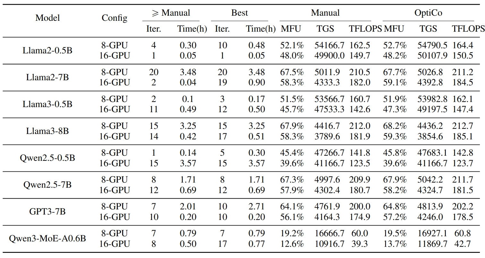

<!-- markdownlint-disable MD041 -->

南湖调度系统用户可参考：https://github.com/TangZhe96/OptiCo


<div align="center">
  <h1><a href="#"></a></h1>
  <h3>Adaptive Distributed Training Optimization via Collaborative Agent Reasoning</h3>
  <p>
    <a href="#-environment-setup">Setup</a> •
    <a href="#️-quick-start">Quick Start</a> •
    <a href="#-dataset">Dataset</a> •
    <a href="#-model">Model</a>
  </p>
</div>

---

## ✨ What is OptiCo?

**OptiCo** is an automated framework that designs optimal distributed training strategies for large-scale AI models using LLM-powered collaborative agents. It eliminates the need for manual tuning and reduces dependency on domain experts.

**Validated across 25+ diverse model and hardware configurations**, OptiCo consistently improves training throughput—**achieving an average speedup of 1.84% (up to 8.65%) within 20 tuning iterations**—and frequently outperforms expert manual configurations with explainable optimization decisions.



*Figure: Performance and efficiency comparison between expert tuning and OptiCo across various models and hardware configurations.*

---

## 🛠️ Environment Setup

### Recommended: Docker Setup (Reproducible Environment)

1. **Pull the official PyTorch container:**
   ```bash
   docker pull nvcr.io/nvidia/pytorch:24.11-py3
   ```
2. **Start the container with GPU support:**
   ```bash
   ./docker_start.sh  # Contains standard NVIDIA Docker runtime setup
   ```
3. **Install Python dependencies:**
   ```bash
   pip install -r requirements.txt
   ```

> **Note:** All paths in this guide assume `/workspace/` as the root directory. Adjust them according to your actual environment.

---

## ⚡ Quick Start

### Run OptiCo with Qwen2.5-7B

Follow these steps to launch an optimization cycle:

1. Navigate to the scripts directory:

   ```bash
   cd /workspace/optico/script
   ```
2. Execute the optimization script:

   * **For a single node:**
     ```bash
     bash run_circle.sh qwen2.5 7B 21
     ```
   * **For a multi-node cluster:**
     * On the **master node** (replace `<MASTER_IP>` with its actual IP):
       ```bash
       MASTER_ADDR=<MASTER_IP> WORLD_SIZE=2 RANK=0 bash run_circle_multinode.sh qwen2.5 7B 21
       ```
     * On a **worker node**:
       ```bash
       MASTER_ADDR=<MASTER_IP> WORLD_SIZE=2 RANK=1 bash run_circle_multinode.sh qwen2.5 7B 21
       ```

   > **Parameter Explanation:**
   >
   > * The final number (`21`) specifies the total number of tuning iterations.
   > * For multi-node runs, ensure `WORLD_SIZE` matches the total number of processes and `RANK` is unique for each.
   >

### Explore More Commands

To view all available utility commands and scripts:

```bash
cat /workspace/optico/script/cmd.sh
```

---

## 📝 Dataset

OptiCo uses standard preprocessed datasets in the Megatron-LM format. Prepare your data as follows:

1. **Llama-2 Dataset:**
   ```bash
   cd /workspace/dataset/
   mkdir -p llama2 && cd llama2
   wget https://atp-modelzoo-wlcb-pai.oss-cn-wulanchabu.aliyuncs.com/release/models/pai-megatron-patch/llama2-datasets/wudao_llamabpe_text_document.bin
   wget https://atp-modelzoo-wlcb-pai.oss-cn-wulanchabu.aliyuncs.com/release/models/pai-megatron-patch/llama2-datasets/wudao_llamabpe_text_document.idx
   ```
2. **Llama-3 Dataset:**
   ```bash
   cd /workspace/dataset/
   mkdir -p llama3 && cd llama3
   wget https://atp-modelzoo-wlcb-pai.oss-cn-wulanchabu.aliyuncs.com/release/models/pai-megatron-patch/llama3-datasets/wudao_llama3bpe_content_document.bin
   wget https://atp-modelzoo-wlcb-pai.oss-cn-wulanchabu.aliyuncs.com/release/models/pai-megatron-patch/llama3-datasets/wudao_llama3bpe_content_document.idx
   ```
3. **Qwen2.5 Dense Model Dataset:**
   ```bash
   cd /workspace/dataset/
   mkdir -p qwen && cd qwen
   wget https://atp-modelzoo-wlcb-pai.oss-cn-wulanchabu.aliyuncs.com/release/models/pai-megatron-patch/qwen-datasets/wudao_qwenbpe_text_document.bin
   wget https://atp-modelzoo-wlcb-pai.oss-cn-wulanchabu.aliyuncs.com/release/models/pai-megatron-patch/qwen-datasets/wudao_qwenbpe_text_document.idx
   ```
4. **Qwen3 MoE Model Dataset:**
   ```bash
   cd /workspace/dataset/
   mkdir -p qwen3_moe && cd qwen3_moe
   wget https://atp-modelzoo-wlcb-pai.oss-cn-wulanchabu.aliyuncs.com/release/models/pai-megatron-patch/qwen-datasets/mmap_qwen3_datasets_text_document.bin
   wget https://atp-modelzoo-wlcb-pai.oss-cn-wulanchabu.aliyuncs.com/release/models/pai-megatron-patch/qwen-datasets/mmap_qwen3_datasets_text_document.idx
   ```

---

## 🤗 Model

Download model checkpoints from Hugging Face for training or inference.

| Model               | Hugging Face Link                                                               | Purpose   |
| :------------------ | :------------------------------------------------------------------------------ | :-------- |
| **Llama-2-7B**      | [meta-llama/Llama-2-7b-hf](https://huggingface.co/meta-llama/Llama-2-7b-hf)     | Training  |
| **Llama-3-8B**      | [meta-llama/Meta-Llama-3-8B](https://huggingface.co/meta-llama/Meta-Llama-3-8B) | Training  |
| **Qwen2.5-7B**      | [Qwen/Qwen2.5-7B](https://huggingface.co/Qwen/Qwen2.5-7B)                       | Training  |
| **Qwen3-MoE-A0.6B** | [MythWorxAI/Qwen3-mini-moe](https://huggingface.co/MythWorxAI/Qwen3-mini-moe)   | Training  |
| **GPT-5.2**         | [OpenAI API Guide](https://platform.openai.com/docs/guides/latest-model)        | Inference |
| **GLM-4.6**         | [Zhipu AI Guide](https://docs.z.ai/guides/llm/glm-4.6)                          | Inference |
| **o3-2025-04-16**   | [OpenAI o3 Guide](https://platform.openai.com/docs/models/o3)                   | Inference |
